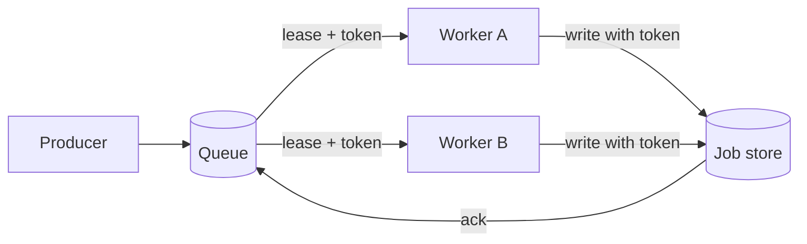

# How a job queue survives a crash

A worker that takes a job holds it under a **lease**: a time-limited claim the queue hands out and takes back. Leases are what let the queue recover from a worker that dies halfway through a job. They are also what lets two workers believe they own the same job at once, which is why every lease comes with a **fencing token**.

> [!NOTE]
> This page walks one job through three scenarios: the happy path, a crash, and a long pause. Use ← and → on any figure to step it, or link a reader straight to a step.

## The lease, step by step

```kiwi-app id=lease controls=host width=wide caption="A paused worker outlives its lease. The fencing token is what makes its late write harmless."
<div class="k-app">
  <div class="k-eyebrow">Lease and fencing token</div>
  <h2 class="k-title" id="title"></h2>
  <p class="k-lede" id="note"></p>
  <ol class="k-steps" id="steps"></ol>
  <div class="k-lanes">
    <div class="k-lane" id="lane-a"><div class="k-eyebrow">Worker A</div><span id="state-a"></span></div>
    <div class="k-lane" id="lane-b"><div class="k-eyebrow">Worker B</div><span id="state-b"></span></div>
    <div class="k-lane on"><div class="k-eyebrow">Job store</div><span id="state-s"></span></div>
  </div>
  <div class="k-track" aria-hidden="true">
    <div class="k-bar" id="bar-a"></div>
    <div class="k-bar" id="bar-b"></div>
    <div class="k-now" id="now"></div>
  </div>
  <dl class="k-kv">
    <dt>holder</dt><dd id="holder"></dd>
    <dt>token</dt><dd id="token"></dd>
    <dt>store accepts token</dt><dd id="min"></dd>
  </dl>
  <div class="k-out" id="out"></div>
  <div class="k-ctl">
    <button class="k-btn" onclick="kiwi.prev()">Back</button>
    <button class="k-btn primary" onclick="kiwi.next()">Next</button>
    <span class="k-pill" id="step-label" data-testid="step-label"></span>
  </div>
</div>
<script>
  var frames = [
    { label: "Acquire", note: "Worker A takes the lease for 30 s and receives token 41.", a: "running", b: "idle", s: "job 7 leased to A", holder: "A", token: 41, min: "≥ 41", now: 10, barA: [5, 45], barB: null, tone: "ok", out: "" },
    { label: "Pause", note: "A stops for a long garbage-collection pause. Its lease keeps ticking.", a: "paused", b: "idle", s: "job 7 leased to A", holder: "A", token: 41, min: "≥ 41", now: 35, barA: [5, 45], barB: null, tone: "warn", out: "" },
    { label: "Expire", note: "The lease runs out. The queue takes the job back; A does not know.", a: "paused", b: "idle", s: "job 7 available", holder: "nobody", token: 41, min: "≥ 41", now: 48, barA: [5, 45], barB: null, tone: "warn", out: "" },
    { label: "Takeover", note: "Worker B leases the job and receives token 42. It writes its result.", a: "paused", b: "running", s: "result from B (token 42)", holder: "B", token: 42, min: "≥ 42", now: 62, barA: [5, 45], barB: [50, 90], tone: "info", out: "" },
    { label: "Stale write", note: "A wakes up and writes with token 41. The store has seen 42, so it refuses.", a: "rejected", b: "done", s: "result from B (token 42)", holder: "B", token: 42, min: "≥ 42", now: 80, barA: [5, 45], barB: [50, 90], tone: "bad", out: "Write with token 41 rejected: the store already accepted 42." }
  ];

  function lane(id, state) {
    var el = document.getElementById(id);
    el.className = "k-lane " + (state === "running" || state === "done" ? "on" : state === "paused" ? "paused" : state === "rejected" ? "dead" : "");
  }

  function bar(id, span) {
    var el = document.getElementById(id);
    if (!span) { el.style.display = "none"; return; }
    el.style.display = "";
    el.style.left = span[0] + "%";
    el.style.width = (span[1] - span[0]) + "%";
  }

  function render(i) {
    var f = frames[i];
    document.getElementById("title").textContent = f.label;
    document.getElementById("note").textContent = f.note;
    document.getElementById("steps").innerHTML = frames.map(function (g, j) {
      return '<li class="' + (j < i ? "on" : j === i ? "now" : "") + '">' + g.label + "</li>";
    }).join("");
    lane("lane-a", f.a);
    lane("lane-b", f.b);
    document.getElementById("state-a").textContent = f.a;
    document.getElementById("state-b").textContent = f.b;
    document.getElementById("state-s").textContent = f.s;
    bar("bar-a", f.barA);
    bar("bar-b", f.barB);
    document.getElementById("now").style.left = f.now + "%";
    document.getElementById("holder").textContent = f.holder;
    document.getElementById("token").textContent = String(f.token);
    document.getElementById("min").textContent = f.min;
    var out = document.getElementById("out");
    out.textContent = f.out;
    out.className = "k-out bad" + (f.out ? " on" : "");
    var pill = document.getElementById("step-label");
    pill.className = "k-pill " + f.tone;
    pill.textContent = "Step " + (i + 1) + " of " + frames.length + ": " + f.label;
  }

  kiwi.steps({
    count: frames.length,
    labels: frames.map(function (f) { return f.label; }),
    onStep: render
  });
</script>
```

The store does the fencing, not the worker. A worker cannot know it has been paused; the store can always compare tokens.

## Where the lease lives

```kiwi-steps id=lease-flow caption="One job, from enqueue to an acknowledged result"
diagram: |
  flowchart LR
    P[Producer] --> Q[(Queue)]
    Q -->|lease + token| W1[Worker A]
    Q -->|lease + token| W2[Worker B]
    W1 -->|write with token| S[(Job store)]
    W2 -->|write with token| S
    S -->|ack| Q
steps:
  - note: "A producer enqueues the job. Nothing holds it yet."
    focus: [P, Q]
    dim: [W1, W2, S]
  - note: "Worker A leases it. The queue records the holder, the expiry and the token."
    focus: [Q, W1]
    dim: [W2, S]
  - note: "A pauses past its expiry, so the queue hands the job to Worker B with a higher token."
    focus: [Q, W2]
    dim: [S]
  - note: "Both workers may try to write. The store keeps the highest token it has seen and rejects the rest."
    focus: [W1, W2, S]
  - note: "The accepted write is acknowledged, and only then is the job removed from the queue."
    focus: [S, Q]
    dim: [P]
```

The two places a crash can bite are the hand-off to Worker B and the acknowledgement. Here is the same diagram with those highlighted:



## The messages

```sequence id=lease-messages caption="Leasing, renewing and writing a job"
participants:
  - {id: W, label: Worker}
  - {id: Q, label: Queue}
  - {id: S, label: Job store, shape: cylinder}
items:
  - {from: W, to: Q, label: "lease(job 7, 30 s)"}
  - {from: Q, to: W, label: "granted, token 41", kind: reply}
  - {from: W, to: Q, label: "renew(job 7, token 41)", kind: async}
  - {from: W, to: S, label: "write(result, token 41)"}
  - {from: S, to: W, label: "ok", kind: reply}
  - {from: W, to: Q, label: "ack(job 7, token 41)"}
frames:
  - {kind: loop, label: "[every 10 s while working]", from: 2, to: 2}
steps:
  - note: "The worker asks for the job with a 30 second lease."
  - note: "The queue grants it and returns a fencing token."
  - note: "While it works, the worker renews well before the lease expires."
  - note: "Every write carries the token."
  - note: "The store accepts it because no higher token has been seen."
  - note: "The ack releases the lease and removes the job."
```

## Three scenarios

::::tabs
:::tab{label="Happy path"}
The worker leases the job, renews every 10 seconds, writes once with its token and acknowledges. The lease never expires, so no other worker sees the job.
:::

:::tab{label="Crash"}
The worker dies after leasing. It never renews, so the lease expires after 30 seconds and the job becomes visible again. The next worker gets a higher token. If the first worker had written half a result, the second worker's write replaces it: writes must be **idempotent per job**.
:::

:::tab{label="Pause"}
The worker is alive but frozen: a long GC pause, a VM migration, a laptop lid. From the queue's side this is indistinguishable from a crash. The difference is that the paused worker wakes up and keeps going, and its write arrives late, carrying an old token. The store rejects it.
:::
::::

> [!WARNING]
> Renewing the lease is not enough on its own. A pause can start right after a successful renewal and last longer than the lease. Only the token check at the store closes the gap.

## How many workers?

```kiwi-calc
jobs_per_day: 12.5 million
job_seconds: 0.8 s        # median processing time
peak_factor: 3            # peak hour over average
lease: 30 s
---
avg_rate: jobs_per_day / day
peak_rate: avg_rate * peak_factor
busy_workers: peak_rate * job_seconds
workers_with_headroom: busy_workers * 1.5
renewals_per_sec: workers_with_headroom / 10
```

## Choosing a lease length

:::figure{width=wide caption="Short leases recover fast but renew often; long leases are cheap but leave a dead worker's job stranded."}
| Lease | Recovery after a crash | Renewals per worker per hour | Risk from a long pause | Good for |
|---|---|---|---|---|
| 5 s | about 5 s | 1,440 | High: GC pauses often exceed it | Very short, latency-sensitive jobs |
| 30 s | about 30 s | 360 | Moderate | Most background jobs |
| 5 min | up to 5 min | 24 | Low | Long batch jobs with checkpoints |
| 1 h | up to 1 h | 2 | Very low | Jobs that cannot be retried cheaply |
:::

> [!TIP]
> Pick the lease from how long you can tolerate a stranded job, then set the renewal interval to a third of it.
