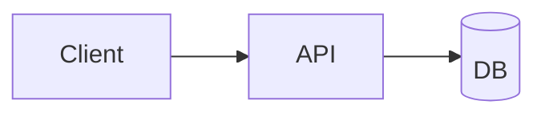

# Fences

```array
values: [3, 1, 4, 1, 5, 9]
highlight: [2, 4]
```

```tree
root:
  value: 8
  left: { value: 3 }
  right: { value: 10 }
```

```kiwi-app
<div class="k-card">
  <button class="k-btn" onclick="kiwi.toast('hi')">Say hi</button>
</div>
```



```ts
export function add(a: number, b: number): number {
  return a + b;
}
```

~~~
tilde fence, no language
~~~

    indented code block
    second line
